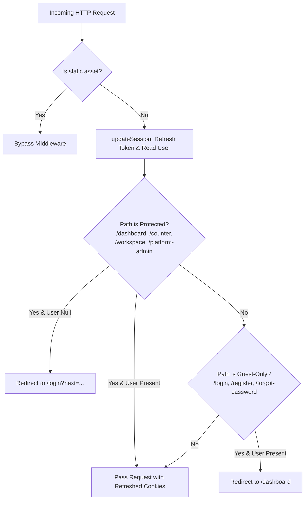

# VyapOne Authentication & Account Lifecycle Architecture

## 1. Executive Summary

This document specifies the authentication, account lifecycle, session management, and route protection architecture implemented for VyapOne under task **VO-021** (Phase P2: Platform Identity, Authentication and Multi-Tenancy).

The system uses **Supabase Auth (GoTrue)** paired with `@supabase/ssr` to implement secure, server-side verified sessions, multi-modal sign-in (India-primary Mobile SMS OTP and Email/Password), password recovery, and Next.js 15 Middleware route boundaries.

---

## 2. Security & Architectural Invariants

| Principle | Implementation |
| :--- | :--- |
| **Zero Client Secrets** | Client components exclusively use the public Supabase Anon key (`NEXT_PUBLIC_SUPABASE_ANON_KEY`). Service role keys are strictly quarantined in `src/lib/supabase/admin.ts` behind `server-only`. |
| **Server-Verified Sessions** | Authentication decisions and middleware token refreshes rely on `supabase.auth.getUser()`, which validates the JWT directly with the Supabase Auth server, rather than trusting unverified client claims. |
| **No Account Enumeration** | Password recovery and failed login attempts return uniform responses (`"If an account with that email exists, instructions have been sent"` / `"Invalid login credentials"`) to prevent hostile user enumeration. |
| **Open Redirect Defense** | All redirect targets from query parameters (`next`, `redirectTo`) are validated through `isValidInternalRedirect()`. Protocol-relative URLs (`//evil.com`), Windows backslash escapes (`/\evil.com`), external schemes, and control characters are strictly rejected. |
| **Indian Telecom / E.164 Invariant** | Indian mobile numbers (10 digits starting with 6–9) are normalized to standard E.164 (`+91xxxxxxxxxx`) via `normalizePhoneNumber()` before persisting or submitting to auth providers. |
| **Dual Identity Bridging** | Supabase managed identity in `auth.users` is automatically bridged to application identity in `public.users` and `public.user_auth_identities` via a PostgreSQL `SECURITY DEFINER` trigger with application-level idempotent fallback (`ensureUserProfile()`). |

---

## 3. Directory Structure & Key Modules

```
src/
├── app/
│   ├── (auth)/
│   │   ├── login/page.tsx               # Interactive Sign-In screen (SMS OTP + Email/Password tabs)
│   │   ├── register/page.tsx            # Merchant / Reseller registration screen
│   │   ├── forgot-password/page.tsx     # Password recovery request screen
│   │   ├── update-password/page.tsx     # New password configuration screen
│   │   └── verify-email/page.tsx        # Email verification dispatched notice
│   └── auth/
│       └── callback/route.ts            # PKCE code exchange Route Handler (GET)
├── components/
│   └── auth/
│       ├── login-form.tsx               # Accessible login form with OTP / password tabs
│       ├── register-form.tsx            # Accessible multi-field registration form
│       ├── forgot-password-form.tsx     # Accessible password reset request form
│       └── update-password-form.tsx     # Accessible password update form
├── lib/
│   ├── auth/
│   │   ├── actions.ts                   # Next.js Server Actions ("use server")
│   │   ├── profile.ts                   # User profile bootstrap & identity linker
│   │   ├── schemas.ts                   # Zod validation schemas for auth payloads
│   │   └── security.ts                  # Open redirect validation, E.164 normalization, error sanitizer
│   └── supabase/
│       ├── client.ts                    # Browser-safe Supabase client (Client Components)
│       ├── server.ts                    # Request-scoped Supabase client (Server Components / Actions)
│       ├── middleware.ts                # Session token refresher (Edge Middleware)
│       └── admin.ts                     # Privileged Supabase Admin client (server-only)
└── middleware.ts                        # Next.js 15 Root Middleware (route protection)
```

---

## 4. Authentication Lifecycle Flows

### 4.1 Account Registration
1. User submits registration details via `/register` (`fullName`, `businessName`, `email`, optional `phone`, `password`, `accountType`).
2. Input is validated against `signUpSchema`.
3. `signUpAction` calls `supabase.auth.signUp()`, storing metadata.
4. If session is not immediately established (email confirmation enabled), user is redirected to `/verify-email`.
5. Database trigger `handle_new_auth_user()` creates `public.users` and `public.user_auth_identities`.

### 4.2 Sign-In with Mobile SMS OTP (India-Primary)
1. **Request OTP:** User enters 10-digit mobile number at `/login`.
2. Input is normalized to `+91xxxxxxxxxx` via `normalizePhoneNumber()`.
3. `requestPhoneOtpAction` invokes `supabase.auth.signInWithOtp({ phone, options: { channel: 'sms' } })`.
4. User receives 6-digit OTP via SMS / WhatsApp.
5. **Verify OTP:** User inputs 6-digit code.
6. `verifyPhoneOtpAction` calls `supabase.auth.verifyOtp({ phone, token, type: 'sms' })`.
7. Session cookies are written to the browser; user is redirected to `/dashboard` (or validated `next` destination).

### 4.3 Sign-In with Email & Password
1. User enters registered email and password.
2. `signInWithPasswordAction` validates input and invokes `supabase.auth.signInWithPassword()`.
3. On success, `ensureUserProfile()` ensures application table records exist.
4. User is redirected to `/dashboard` (or validated `next` path).

### 4.4 PKCE Code Exchange Callback (`/auth/callback`)
- Route Handler at `src/app/auth/callback/route.ts` captures query parameters: `code` and `next`.
- Exchanges authorization code for session via `supabase.auth.exchangeCodeForSession(code)`.
- Validates `next` destination with `isValidInternalRedirect()`.
- Bootstraps `public.users` via `ensureUserProfile()`.
- Redirects user to their target destination (defaults to `/dashboard`).

### 4.5 Password Recovery & Reset
1. User requests password reset via `/forgot-password`.
2. `requestPasswordResetAction` calls `supabase.auth.resetPasswordForEmail()` with redirect URL to `/auth/callback?next=/update-password`.
3. Always returns uniform success: `"If an account with that email exists, we have sent instructions to reset your password."`
4. User clicks link in email, arrives at `/auth/callback`, is exchanged into an authenticated session, and lands at `/update-password`.
5. User enters new password, which is validated by `updatePasswordSchema`.
6. `updatePasswordAction` calls `supabase.auth.updateUser({ password })`.
7. User is redirected to `/dashboard`.

### 4.6 Sign-Out
1. `signOutAction` calls `supabase.auth.signOut()`.
2. Supabase invalidates the session and clears auth cookies.
3. User is redirected to `/login`.

---

## 5. Next.js 15 Middleware Route Protection

The root middleware at `src/middleware.ts` runs on incoming HTTP requests (excluding static assets and images) and enforces:



### Cookie Preservation on Redirect
When Next.js returns a `NextResponse.redirect()`, standard redirect responses drop headers from intermediate responses. To prevent dropping refreshed session cookies, `copyCookies(response, redirectResponse)` copies all updated cookies from `supabaseResponse` to the redirected response.

---

## 6. Database Triggers & Migration

### Migration: `supabase/migrations/20261112000002_auth_profile_trigger.sql`
- Creates function `public.handle_new_auth_user()` with `SECURITY DEFINER` and `SET search_path = public, auth`.
- Listens to `AFTER INSERT OR UPDATE ON auth.users`.
- Inserts `public.users` with `display_name`, `email`, `phone_number`, `status = 'active'`, and `preferred_language = 'en'`.
- Inserts identity record into `public.user_auth_identities` (`provider`, `identifier`, `verified_at`).
- Handles conflict resolution safely (`ON CONFLICT (id) DO UPDATE`).

---

## 7. India Telecom & DLT Considerations

Under Telecom Regulatory Authority of India (TRAI) guidelines:
1. SMS headers (Sender IDs) and message templates must be registered on an approved Distributed Ledger Technology (DLT) platform (e.g., Vilpower, PingConnect, Airtel DLT).
2. OTP SMS templates must use registered Principal Entity (PE) IDs and Template IDs.
3. Supabase Auth supports custom SMS providers (Twilio, MessageBird, or custom webhook) to route SMS via Indian DLT-compliant gateways.
4. In production, WhatsApp OTP can serve as an alternative delivery channel via WhatsApp Business API.

---

## 8. Verification & Quality Gates

The authentication foundation has been verified across:
- **Unit Test Coverage:** 5 test suites with 55 unit tests in `tests/unit/auth/` covering validation schemas, open redirect defense, error sanitization, middleware route boundaries, profile bootstrapping, and server actions.
- **Full Suite Integration:** 248 total project unit tests passing with zero regressions.
- **Type Safety:** `pnpm typecheck` passed with 0 errors (`strict: true`, zero `any` types).
