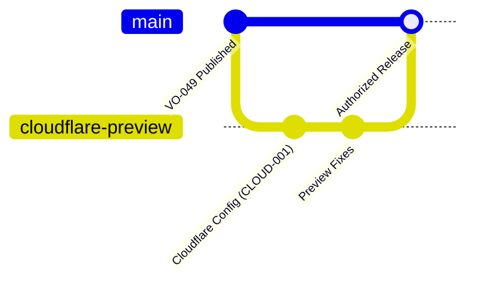

# Cloudflare Workers Deployment Guide (CLOUD-001 - CLOUD-009)

> [!WARNING]
> **Release Status: NO-GO (DEPLOYMENT BLOCKED)**  
> 1. In **CLOUD-007**, **CLOUD-008**, & **CLOUD-009**, local SQL remediation (`20261122000002`, `20261122000003`, `20261125000001`), `supabase/seed.sql`, website role parity, pgTAP integration suite `00002_security_and_rpc_integration_test.sql`, and Linux CI `supabase test db` wiring were completed (see [`docs/CLOUD-008_RECOVERY_AND_CI_READINESS.md`](file:///f:/VyaponeV2/docs/CLOUD-008_RECOVERY_AND_CI_READINESS.md) and [`docs/CLOUD-009_INVITATION_AND_DATABASE_TEST_REMEDIATION.md`](file:///f:/VyaponeV2/docs/CLOUD-009_INVITATION_AND_DATABASE_TEST_REMEDIATION.md)).  
> 2. **Remaining Blockers:** (a) Historical migration `20261117000002` still prevents clean empty-DB `supabase db reset` until `ADR-028` (Option D pre-check + chosen recovery) is explicitly approved; (b) `.github/workflows/cloudflare-validation.yml` has not been pushed to `origin/main` (`VyaponeV1.git`) or triggered via `workflow_dispatch`; (c) pending migrations `20261122000001`–`20261125000001` have NOT been applied to production.  
> 3. **PostgreSQL & Linux Runtime Execution:** `NOT RUN` locally on Windows (`docker`, `supabase`, `psql`, `git` absent); Vitest suites run locally with mocks/static SQL checks only.  
> 4. **Production execution authorization: NOT AUTHORIZED.** Pushing to `origin/main` (`VyaponeV1.git`), running production DB writes, and deploying Cloudflare Workers remain blocked pending explicit approval.

---

## 1. Safety Notice & Git Remote Advisory

> [!CAUTION]
> **Git Remote Discrepancy Alert**  
> The current configured Git remote in this repository is:  
> `origin  https://github.com/krishnasharma1907/VyaponeV1.git`  
> 
> The current local repository is **VyapOne V2** (`F:\VyaponeV2`).  
> In accordance with strict safety invariants, **no automatic Git remote change, Git push, or GitHub connection has been performed.**
> 
> **Before pushing code or connecting Cloudflare Workers Builds:**
> 1. Ensure the user confirms or updates the Git remote to the intended repository (e.g., `VyaponeV2.git`).
> 2. Pushes must only be made to the dedicated preview branch (`cloudflare-preview`), never directly to `main` without review.
> 3. Production deployments on Cloudflare must remain **disabled** until authorized.

---

## 2. Architecture & Compatibility Overview

VyapOne is a full-stack Next.js application leveraging React 19 Server Components (RSC), Server Actions, Next.js App Router, Route Handlers, and Supabase.

For production deployment on Cloudflare Workers, the project uses **OpenNext for Cloudflare** (`@opennextjs/cloudflare@1.20.18` and `wrangler@4.166.0`), aligning with the existing live worker `vyapone` (`https://vyapone.kssharma2022krish.workers.dev/`).

### OpenNext Stack & Invariants:
- **Adapter:** `@opennextjs/cloudflare@1.20.18`
- **CLI / Runtime:** `wrangler@4.166.0`
- **Worker Entry Point:** `.open-next/worker.js`
- **Static Assets:** `.open-next/assets`
- **App Router:** 35 pages, 7 layouts, 4 route handlers, and `src/middleware.ts` fully bundled.
- **Node.js Built-ins:** Supported via Cloudflare Workers' `nodejs_compat` flag with compatibility date `2024-12-30`.
- **Environment Resolution:** `src/config/env.ts` resolves environment variables from both `process.env` and global bindings.

---

## 3. Cloudflare Configuration (`wrangler.jsonc` & `open-next.config.ts`)

The project uses an aligned `wrangler.jsonc` and `open-next.config.ts` at the repository root:

```jsonc
{
  "$schema": "node_modules/wrangler/config-schema.json",
  "name": "vyapone",
  "compatibility_date": "2024-12-30",
  "compatibility_flags": ["nodejs_compat"],
  "main": ".open-next/worker.js",
  "assets": {
    "directory": ".open-next/assets",
    "binding": "ASSETS"
  },
  "observability": {
    "enabled": true
  },
  "env": {
    "preview": {
      "name": "vyapone-preview",
      "vars": {
        "NEXT_PUBLIC_APP_ENV": "preview"
      }
    },
    "production": {
      "name": "vyapone",
      "vars": {
        "NEXT_PUBLIC_APP_ENV": "production"
      }
    }
  }
}
```

### OpenNext Configuration (`open-next.config.ts`):
```ts
import { defineCloudflareConfig } from "@opennextjs/cloudflare";

export default defineCloudflareConfig({
  // OpenNext Cloudflare configuration
  // Handles Next.js 15 App Router features, SSR, and assets
});
```

### Dedicated Scripts:
- `pnpm preview:cloudflare`: `opennextjs-cloudflare build && opennextjs-cloudflare preview`
- `pnpm deploy:cloudflare`: `opennextjs-cloudflare build && opennextjs-cloudflare deploy`

---

## 4. Environment Variables Inventory & Secret Separation

Environment variables are partitioned into three distinct tiers. **Never commit real secrets or `.env` files into Git.**

### Tier 1: Public Client Variables (Safe for Browser)
These variables are bundled into client-side code and exposed publicly:

| Variable | Environment | Example / Value | Description |
| :--- | :--- | :--- | :--- |
| `NEXT_PUBLIC_APP_ENV` | Preview | `preview` | Identifies preview runtime environment. |
| `NEXT_PUBLIC_APP_URL` | Preview | `https://vyapone-preview.<account>.workers.dev` | Canonical preview origin URL. |
| `NEXT_PUBLIC_SUPABASE_URL` | Staging | `https://<staging-ref>.supabase.co` | Supabase Staging project URL. |
| `NEXT_PUBLIC_SUPABASE_ANON_KEY` | Staging | `<staging-anon-jwt>` | Public Supabase anon key (guarded by RLS). |

### Tier 2: Server-Only Core Secrets (Privileged — Never Exposed to Client)
These must be set as encrypted secrets in the Cloudflare Dashboard under **Workers & Pages > vyapone-preview > Settings > Variables and Secrets**:

| Secret Key | Target | Minimum Requirement | Description |
| :--- | :--- | :--- | :--- |
| `NODE_ENV` | Preview | `production` | Enables optimized production runtime. |
| `SESSION_SECRET` | Preview | 32+ random characters | Encrypts session cookies. |
| `DATABASE_URL` | Staging | `postgresql://...` | Supabase Staging connection pooler URL (port 6543 / 5432). |
| `DATABASE_DIRECT_URL` | Staging | `postgresql://...` | Supabase Staging direct PostgreSQL connection URL. |
| `SUPABASE_SERVICE_ROLE_KEY` | Staging | 32+ char JWT | Privileged key for server-side auth/admin tasks. |

### Tier 3: Optional Integrations (Staging / Mock)
If configured for preview testing, configure in Cloudflare dashboard as secrets:
- `RAZORPAY_KEY_ID` / `RAZORPAY_KEY_SECRET` (Use Razorpay **Test Mode** keys only `rzp_test_*`).
- `STORAGE_ENDPOINT`, `STORAGE_BUCKET`, `STORAGE_ACCESS_KEY_ID`, `STORAGE_SECRET_ACCESS_KEY` (Staging R2 bucket).
- `META_WHATSAPP_TOKEN`, `META_WHATSAPP_PHONE_NUMBER_ID` (Sandbox test numbers only).
- `ANTHROPIC_API_KEY` / `GEMINI_API_KEY` (Test API keys with strict quotas).

---

## 5. Supabase Staging Isolation & Security

> [!IMPORTANT]
> **Strict Tenant & Data Isolation Rule**  
> Never point preview deployments to the production database or production Supabase project. A preview environment must run against a **dedicated Supabase Staging project**.

### 1. Staging Database Setup
1. Create a dedicated Supabase project (e.g. `vyapone-staging`).
2. Run database migrations sequentially against staging:
   ```bash
   pnpm db:migration:up # or via Supabase CLI linked to staging ref
   ```
3. Never run destructive operations (`db reset`) on production or staging without a verified backup.

### 2. Supabase Auth Configuration (Redirect URLs)
In the Supabase Dashboard under **Authentication > URL Configuration**:
1. **Site URL:**
   - Set to your preview base URL: `https://vyapone-preview.<account>.workers.dev`
2. **Redirect URLs (Allow-list):**
   - `http://localhost:3000/auth/callback` (Local development)
   - `https://vyapone-preview.<account>.workers.dev/auth/callback` (Primary preview Worker)
   - `https://*.vyapone-preview.workers.dev/auth/callback` (Branch preview deployments)
   - `https://*.workers.dev/auth/callback`

### 3. Supabase Storage & CORS
Configure CORS on the staging storage bucket (`vyapone-media`):
- Allowed Origins: `http://localhost:3000`, `https://*.workers.dev`, `https://*.vyapone.in`.
- Allowed Methods: `GET`, `POST`, `PUT`, `DELETE`, `HEAD`.
- Allowed Headers: `*`.

---

## 6. Branch Strategy & Cloudflare Workers Builds Setup

To ensure zero risk of accidental production deployments, adopt the branch strategy below:



### 1. Dedicated Branches
- **`main`**: Production code branch. Cloudflare automated production deployments must remain **disabled** until full sign-off.
- **`cloudflare-preview`**: Dedicated integration branch for Cloudflare Workers preview deployments.

### 2. Cloudflare Workers Builds Configuration
Refer to [Cloudflare Workers CI/CD Builds Documentation](https://developers.cloudflare.com/workers/ci-cd/builds/):
1. In the Cloudflare Dashboard, navigate to **Workers & Pages** > **Create application** > **Connect to Git**.
2. Select the verified GitHub repository (e.g., `VyaponeV2`).
3. Set **Production branch** to `main` (Set "Automatic deployments" for production to **OFF**).
4. Set **Preview deployment branches** to `cloudflare-preview` (Automatic deployments = **ON**).
5. Build settings:
   - **Framework preset:** `None` / `Custom`
   - **Build command:** `npx @vinext/cloudflare deploy` (or `pnpm build`)
   - **Output directory:** `.next` / `dist`
   - **Environment variables:** Enter the Preview / Staging variables from Tier 1 & Tier 2.

---

## 7. Local Pre-Deployment Verification

Before any commit or deployment, run the full test suite locally:

```bash
# 1. TypeScript type checking (Zero errors allowed)
pnpm typecheck

# 2. ESLint checks (Zero warnings/errors)
pnpm lint

# 3. Code formatting verification
pnpm format:check

# 4. Critical unit and integration tests
pnpm vitest run tests/unit/database/website-publishing-migration.test.ts tests/unit/websites/pre-publish-and-publishing.test.tsx

# 5. Full Next.js production build
pnpm build

# 6. Vinext compatibility audit
pnpm dlx vinext check
```

---

## 8. Post-Authorization Action Plan (For User / Admin)

Once the user approves connecting GitHub and deploying:
1. **Verify Git Remote:** Check and update `git remote set-url origin <correct-VyapOne-V2-URL>`.
2. **Push Preview Branch:** Run `git checkout -b cloudflare-preview && git push -u origin cloudflare-preview`.
3. **Link Cloudflare Worker:** In Cloudflare Dashboard, connect `cloudflare-preview` branch and supply staging environment secrets.
4. **Inspect Live Preview URL:** Test storefront routing, dynamic QR codes, authentication flow, and constrained editor on the provisioned preview host (`*.workers.dev`).
