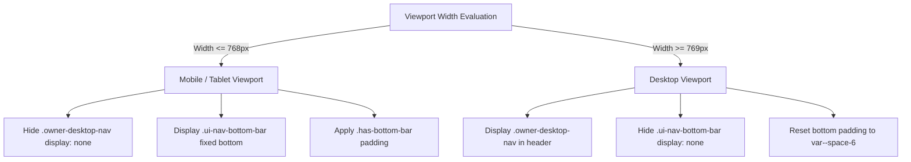

# VyapOne Responsive Design & Mobile Interaction Architecture

**Task ID:** VO-015  
**Phase:** P1 — Repository, Design System and Application Shell  
**Authority:** `reference/PRD_VERSIONS/PRD_FINAL_v2_2026-11-03.md` (§5.6, §12.3, §18.2, §18.3)  
**Status:** Approved & Implemented  

---

## 1. Executive Summary & Design Philosophy

VyapOne is built **mobile-first from the ground up**. Indian retail commerce, Kirana billing, wholesale distribution, and agency merchant management take place on a broad spectrum of hardware:
1. Sub-₹15,000 Android devices with 320px–360px physical widths.
2. Standard modern smartphones (390px × 844px baseline, e.g., iPhone 12/13/14/15/16 and comparable Android devices).
3. Countertop Android/iPad tablets (768px × 1024px) for rapid counter billing and order punching.
4. Desktop laptops and widescreen monitors (1024px–1440px+) for platform governance and agency management.

Every screen and layout primitive in VyapOne strictly enforces:
- **Zero horizontal scroll on mobile viewport boundaries** (`document.documentElement.scrollWidth <= window.innerWidth`).
- **Touch-first hit targets** meeting WCAG 2.2 AA (minimum 44px control height, 48px preferred mobile touch target).
- **Notch, dynamic island, and gesture navigation bar safety** using CSS `env(safe-area-inset-*)` with zero-pixel fallbacks.
- **Virtual keyboard protection** using dynamic viewport height (`100dvh` with `100vh` fallback) and 16px minimum form control font sizes to prevent iOS Safari auto-zoom.

---

## 2. Standard Viewport Breakpoints

The responsive breakpoint scale is defined in `src/design-system/tokens.ts` and mirrored in `src/app/globals.css`:

| Token | CSS Variable | Width | Target Device Category | Behavior & Layout Rules |
| :--- | :--- | :--- | :--- | :--- |
| `xs` | `--breakpoint-xs` | **320px** | Low-cost Androids, small feature-smartphones | Single-column stack, compact gutters (16px), scrollable navigation headers |
| `sm` | `--breakpoint-sm` | **390px** | Standard modern smartphones (Primary Baseline) | Primary mobile experience, fixed bottom navigation bar on owner portals, 48px touch targets |
| `md` | `--breakpoint-md` | **768px** | Tablets, iPads, countertop POS stations | Expanded gutters (24px), multi-column card grids, horizontal tabs, hybrid POS layout |
| `lg` | `--breakpoint-lg` | **1024px** | Compact laptops, tablets landscape | Desktop header navigation enabled, mobile bottom bar hidden, 32px gutters |
| `xl` | `--breakpoint-xl` | **1440px** | Widescreen displays, platform admin governance | Full multi-column analytical dashboards, fixed max-width containers (1280px–1440px) |

---

## 3. Safe Area Insets & Edge Protection

Modern smartphones feature top notches, dynamic islands, and bottom home indicator bars. Without explicit safe-area handling, fixed headers obscure status bars and bottom navigation bars collide with home gestures.

### 3.1 Viewport Metadata
`src/app/layout.tsx` configures the Next.js root viewport with `viewportFit: "cover"`:

```typescript
export const viewport: Viewport = {
  width: "device-width",
  initialScale: 1,
  maximumScale: 5,
  viewportFit: "cover", // Mandatory for safe-area insets
  themeColor: "#0F5132", // VyapOne primary brand emerald
};
```

### 3.2 CSS Custom Properties
`src/app/globals.css` defines safe area variables with automatic fallback to `0px` on standard desktop browsers:

```css
--safe-area-top: env(safe-area-inset-top, 0px);
--safe-area-right: env(safe-area-inset-right, 0px);
--safe-area-bottom: env(safe-area-inset-bottom, 0px);
--safe-area-left: env(safe-area-inset-left, 0px);
```

### 3.3 Layout Container Utilities
- `.app-container`: Enforces left and right page gutters scaled dynamically (`max(var(--page-gutter), env(safe-area-inset-left/right, 0px))`).
- `.app-header`: Applies top safe-area padding (`padding-top: max(var(--space-3), env(safe-area-inset-top, 0px))`).
- `.ui-nav-bottom-bar`: Enforces bottom safe-area padding (`padding-bottom: max(var(--space-2), env(safe-area-inset-bottom, 0px))`).
- `.has-bottom-bar`: Adds dynamic bottom content clearance so main content is never obscured by the fixed bottom navigation bar:
  ```css
  .has-bottom-bar {
    padding-bottom: calc(var(--target-control-height) + var(--space-6) + env(safe-area-inset-bottom, 0px)) !important;
  }
  @media (min-width: 769px) {
    .has-bottom-bar {
      padding-bottom: var(--space-6) !important;
    }
  }
  ```

---

## 4. Mobile Navigation & Role-Aware Shell Transitions

### 4.1 Owner Portal Navigation Switching
The merchant dashboard features a 9-item navigation architecture on desktop and a focused 5-item bottom bar on mobile:



### 4.2 Multi-Tab Scrollable Header Navigation
Route shells with dense horizontal navigation (Reseller Agency Workspace with 5 tabs, Platform Super-Admin Governance with 6 tabs) utilize `.ui-nav-scrollable`:
- Smooth touch momentum scrolling: `-webkit-overflow-scrolling: touch`.
- Horizontal scroll container with scrollbars visually hidden (`scrollbar-width: none`).
- Prevents header tabs from wrapping into vertical stacks or pushing the document width beyond the viewport.

---

## 5. Touch Target Sizes & Virtual Keyboard Ergonomics

### 5.1 Touch Target Compliance (WCAG 2.2 AA)
All interactive primitives comply with touch target dimensions:
- **Minimum Interactive Target (`--target-min`):** `24px` (WCAG 2.2 Criterion 2.5.8).
- **Form Controls & Standard Buttons (`--target-control-height`):** `44px` (Apple HIG minimum).
- **Mobile Preferred CTA (`--target-mobile-preferred`):** `48px` (Android Material standard).
- **POS / Billing List Rows (`--target-table-row`):** `48px` minimum height for fast, error-free finger tapping on counter tablets.

### 5.2 Form Input Font Size Protection
Mobile Safari on iOS automatically zooms in on any form input whose computed `font-size` is strictly less than 16px (`1rem`), causing frustrating viewport displacement and broken horizontal containment.  
All VyapOne inputs (`.ui-input`, `.ui-textarea`, `.ui-select`) enforce:
```css
font-size: var(--font-size-body); /* 1rem = 16px */
```

### 5.3 Dynamic Viewport Height
The utility class `.min-h-screen-safe` ensures that full-height layouts adapt gracefully when mobile on-screen keyboards appear:
```css
.min-h-screen-safe {
  min-height: 100vh;
  min-height: 100dvh;
}
```

---

## 6. Table & Data Grid Containment

Data tables (invoices, GST line items, audit logs, customer rosters) frequently contain 6–10 columns of data that cannot fit within 320px–390px widths.  
The `.ui-table-container` wrapper provides:
```css
.ui-table-container {
  width: 100%;
  overflow-x: auto;
  -webkit-overflow-scrolling: touch;
}
```
This isolates table horizontal scrolling strictly to the container, preventing the table from blowing out the root page layout.

---

## 7. Motion & Accessibility Safeguards

- **Reduced Motion:** All transitions, rotations, and animations respect `@media (prefers-reduced-motion: reduce)` by resetting transition and animation durations to `0.01ms !important`.
- **Focus Rings:** High-visibility 3px focus ring with 2px offset (`outline: 3px solid var(--color-focus-ring)`) ensures complete accessibility for hardware keyboards, Bluetooth barcode scanners, and assistive switches.

---

## 8. Browser Validation Evidence

Automated headless browser testing was executed using Chromium across all 7 representative application routes across 5 viewports (35 test matrix cells total). Every test verified:
- Zero horizontal overflow (`docScrollWidth <= winInnerWidth` and `bodyScrollWidth <= winInnerWidth`).
- Clean rendering and responsive navigation states.

### Validation Matrix Results (100% Pass Rate)

| Viewport Category | Resolution | Route | Document Width | Body Width | Viewport Width | Zero Overflow | Result |
| :--- | :--- | :--- | :--- | :--- | :--- | :--- | :--- |
| **Small Mobile** | 320 × 568 | `/login` | 320px | 320px | 320px | True | **PASS** |
| **Small Mobile** | 320 × 568 | `/s/demo-store` | 320px | 320px | 320px | True | **PASS** |
| **Small Mobile** | 320 × 568 | `/workspace` | 320px | 320px | 320px | True | **PASS** |
| **Small Mobile** | 320 × 568 | `/dashboard` | 320px | 320px | 320px | True | **PASS** |
| **Small Mobile** | 320 × 568 | `/dashboard/billing` | 320px | 320px | 320px | True | **PASS** |
| **Small Mobile** | 320 × 568 | `/counter/pos` | 320px | 320px | 320px | True | **PASS** |
| **Small Mobile** | 320 × 568 | `/platform-admin` | 320px | 320px | 320px | True | **PASS** |
| **Standard Mobile** | 390 × 844 | `/login` | 390px | 390px | 390px | True | **PASS** |
| **Standard Mobile** | 390 × 844 | `/s/demo-store` | 390px | 390px | 390px | True | **PASS** |
| **Standard Mobile** | 390 × 844 | `/workspace` | 390px | 390px | 390px | True | **PASS** |
| **Standard Mobile** | 390 × 844 | `/dashboard` | 390px | 390px | 390px | True | **PASS** |
| **Standard Mobile** | 390 × 844 | `/dashboard/billing` | 390px | 390px | 390px | True | **PASS** |
| **Standard Mobile** | 390 × 844 | `/counter/pos` | 390px | 390px | 390px | True | **PASS** |
| **Standard Mobile** | 390 × 844 | `/platform-admin` | 390px | 390px | 390px | True | **PASS** |
| **Tablet** | 768 × 1024 | `/login` | 768px | 768px | 768px | True | **PASS** |
| **Tablet** | 768 × 1024 | `/s/demo-store` | 768px | 768px | 768px | True | **PASS** |
| **Tablet** | 768 × 1024 | `/workspace` | 768px | 768px | 768px | True | **PASS** |
| **Tablet** | 768 × 1024 | `/dashboard` | 768px | 768px | 768px | True | **PASS** |
| **Tablet** | 768 × 1024 | `/dashboard/billing` | 768px | 768px | 768px | True | **PASS** |
| **Tablet** | 768 × 1024 | `/counter/pos` | 768px | 768px | 768px | True | **PASS** |
| **Tablet** | 768 × 1024 | `/platform-admin` | 768px | 768px | 768px | True | **PASS** |
| **Desktop** | 1024 × 768 | `/login` | 1024px | 1024px | 1024px | True | **PASS** |
| **Desktop** | 1024 × 768 | `/s/demo-store` | 1024px | 1024px | 1024px | True | **PASS** |
| **Desktop** | 1024 × 768 | `/workspace` | 1024px | 1024px | 1024px | True | **PASS** |
| **Desktop** | 1024 × 768 | `/dashboard` | 1024px | 1024px | 1024px | True | **PASS** |
| **Desktop** | 1024 × 768 | `/dashboard/billing` | 1024px | 1024px | 1024px | True | **PASS** |
| **Desktop** | 1024 × 768 | `/counter/pos` | 1024px | 1024px | 1024px | True | **PASS** |
| **Desktop** | 1024 × 768 | `/platform-admin` | 1024px | 1024px | 1024px | True | **PASS** |
| **Large Desktop** | 1440 × 900 | `/login` | 1440px | 1440px | 1440px | True | **PASS** |
| **Large Desktop** | 1440 × 900 | `/s/demo-store` | 1440px | 1440px | 1440px | True | **PASS** |
| **Large Desktop** | 1440 × 900 | `/workspace` | 1440px | 1440px | 1440px | True | **PASS** |
| **Large Desktop** | 1440 × 900 | `/dashboard` | 1440px | 1440px | 1440px | True | **PASS** |
| **Large Desktop** | 1440 × 900 | `/dashboard/billing` | 1440px | 1440px | 1440px | True | **PASS** |
| **Large Desktop** | 1440 × 900 | `/counter/pos` | 1440px | 1440px | 1440px | True | **PASS** |
| **Large Desktop** | 1440 × 900 | `/platform-admin` | 1440px | 1440px | 1440px | True | **PASS** |

### Evidence Artifacts
- **Screenshots Directory:** `docs/evidence/screenshots/` (35 full-fidelity rendered PNGs).
- **Validation Results JSON:** `docs/evidence/responsive_viewport_results.json`.
- **Automated Validation Runner:** `pnpm test:responsive` (`scripts/validate-responsive.mjs`).
